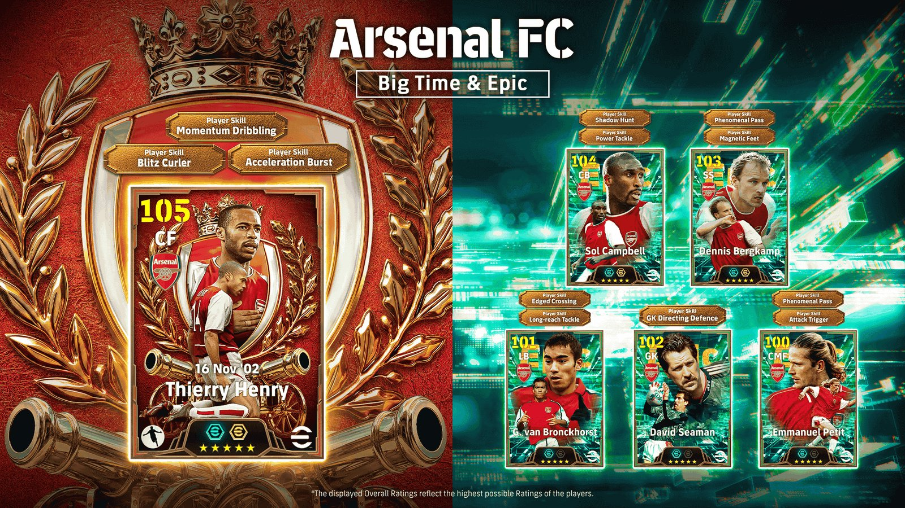

Big Time & Epic: Arsenal FC（11 月 12 日上架，约 12 月 3 日结束，以游戏内倒计时为准），250 人包，100 币/抽，10 连 500 币优惠 1 次。

## 上架球员

- **亨利（Big Time）** 中锋 · 组织前锋：官方展示满级 105，旋风盘带 + 弧线落叶射门（金搓）+ 瞬间加速。速度、盘带、终结全是顶级，本包头牌。
- **坎贝尔（Epic）** 中卫 · 破坏者：官方展示满级 104，紧急回防 + 强力抢断。身体、防空都拉满的铁卫。
- **博格坎普（Epic）** 影锋 · 有创意的中场指挥官：官方展示满级 103，无定形传球 + 磁力脚。脚下最细，组织做球大师，情怀也拉满。
- **佩蒂特（Epic）** 中前卫 · 全能中场：官方展示满级 100，无定形传球 + 进攻号手。攻守均衡的功能型中场，基础总评 86，优先级靠后。
- **希曼（Epic）** 门将 · 防守型门将：官方展示满级 102，门将指挥防线。基础总评 87，老门神，收藏意义大于实战。
- **范布隆克霍斯特（Epic）** 左后卫 · 进攻型后卫：官方展示满级 101，急坠传中（落叶式传中）+ 伸腿拦截。基础总评 86，助攻型边卫，阵容深度补充。

## 结论

250 人大包，抽满才保底全收，成本是全游戏最高一档。只冲亨利也要做好抽满的准备；枪迷情怀包，非阿森纳球迷量力而行。

> 注：六人满级总评均为游戏内官方展示数值（官网主视觉图）；基础总评与风格来自 eFHUB 球员页，技能中文名按定版官方中文名。
