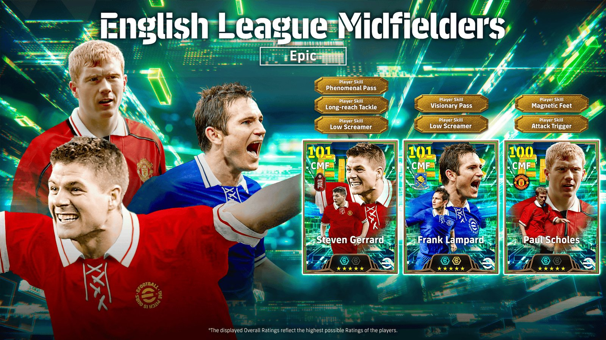

卡包：Epic「English League Midfielders」（英格兰联赛中场）
期间：2026 年 11 月 9 日 – 11 月 16 日，150 人盒（3 Epic + 8 Highlight + 139 现役球员）

> 官网主视觉图来源：Konami eFootball 官网首页 LATEST EVENT 推广位原图（1920×1080）。

## Epic 卡强度分析

总评为 ef-labo 口径，与官网图上标注一致（101 / 101 / 100）。

### 杰拉德 Steven Gerrard（CMF，满级 101）

全能中场（Box To Box），特殊技能三个：无定形传球、掠地瞬击、伸腿拦截，攻防传射一把抓。本包最稳的一张；已有马特乌斯 / 西多夫 / 大本钟赖斯的可跳过。

### 兰帕德 Frank Lampard（CMF，满级 101）

影子前锋（Hole Player）+ 到位传球、掠地瞬击，前插终结三人最强，还能兼顾防守风格。缺一个能进球的前腰就值得追；没有贝林厄姆大卡更香。

### 斯科尔斯 Paul Scholes（CMF，满级 100）

指挥官 + 磁力脚、进攻号手，盘带手感细腻，但速度和防守是短板，终结加点也起不来。三人里最弱，情怀向。

## 整包结论

可选、非必追。杰拉德 ≈ 兰帕德（按阵容缺口选）> 斯科尔斯；三人都有平替，老卡也没被淘汰，没必要硬追保底。
