POTW（11 月 26 日上架，结束时间以游戏内倒计时为准），共 11 张 POTW 卡。总评为 eFHUB 口径：穆里尼奥 90 长传反击＋双增能。单抽金币数以游戏内为准。

## 上架球员

- **阿尔瓦雷斯（POTW）** 中锋 · 组织前锋：双增能 102，自带增能 Passing +3。本期头牌，基础 96 全包最高。

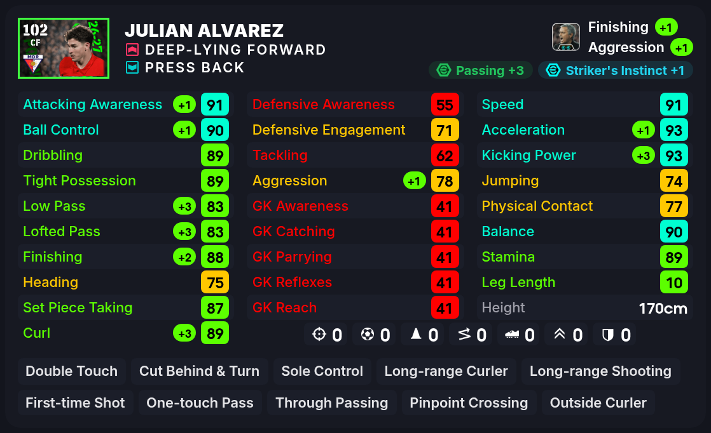

- **维尔茨（POTW）** 前腰 · 影子前锋：双增能 102，自带增能 Accuracy +3。

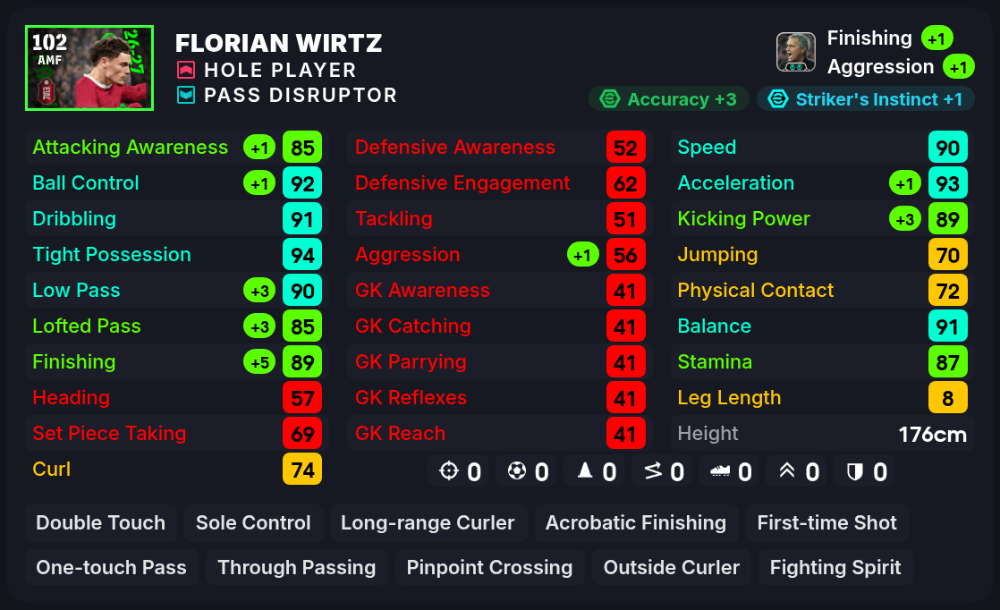

- **马伦（POTW）** 中锋 · 偷猎者：双增能 102，自带增能 Striker's Instinct +3，带超级替补技能。

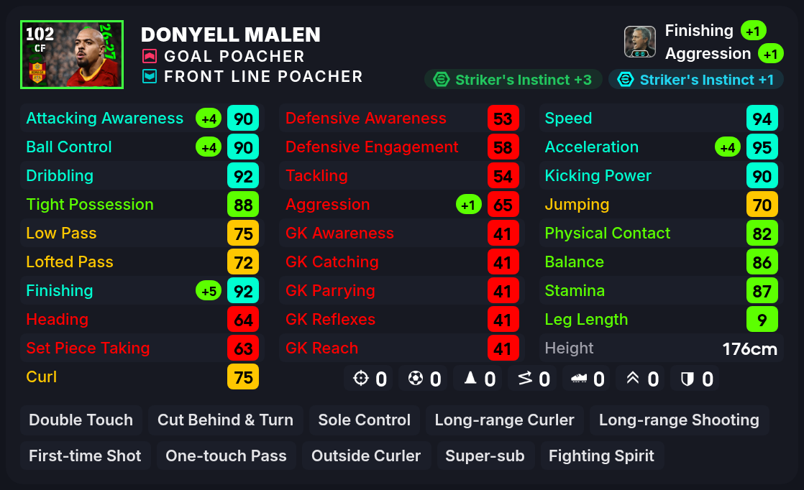

- **杰拉德·马丁（POTW）** 中后卫 · 后场组织者：双增能 101，自带增能 Defending +3。

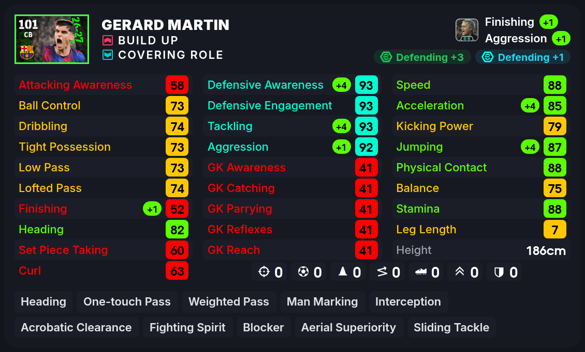

- **扬·库托（POTW）** 右后卫 · 进攻型后卫：双增能 100，自带增能 Crossing +3。

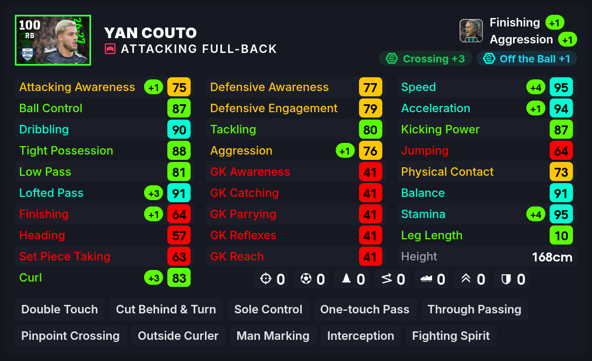

- **科波拉（POTW）** 中后卫 · 破坏者：双增能 100，自带增能 Aerial Block +3。

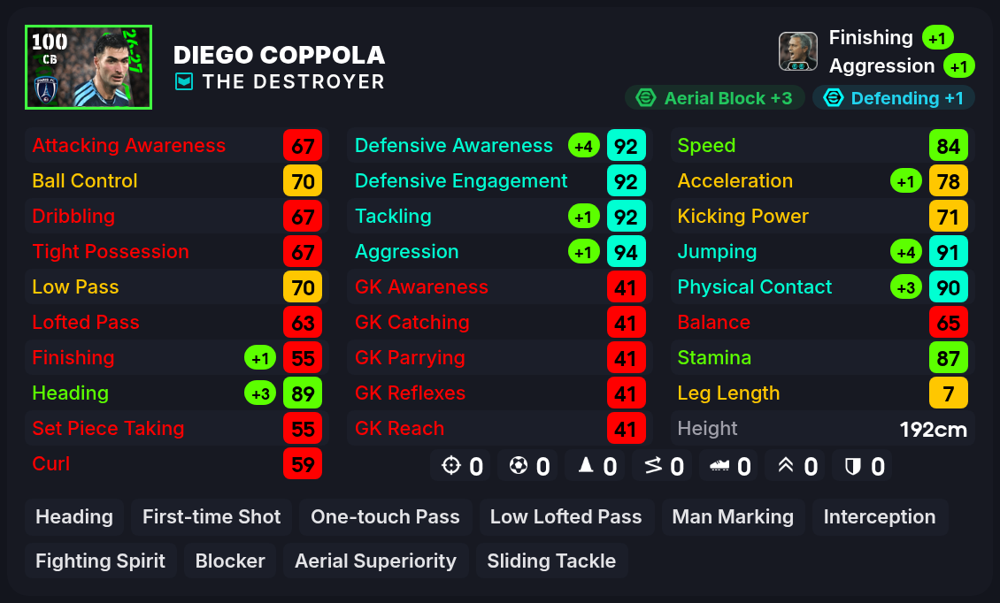

- **莫雷拉（POTW）** 左中场 · 有创意的中场指挥官：双增能 100，自带增能 Technique +3。

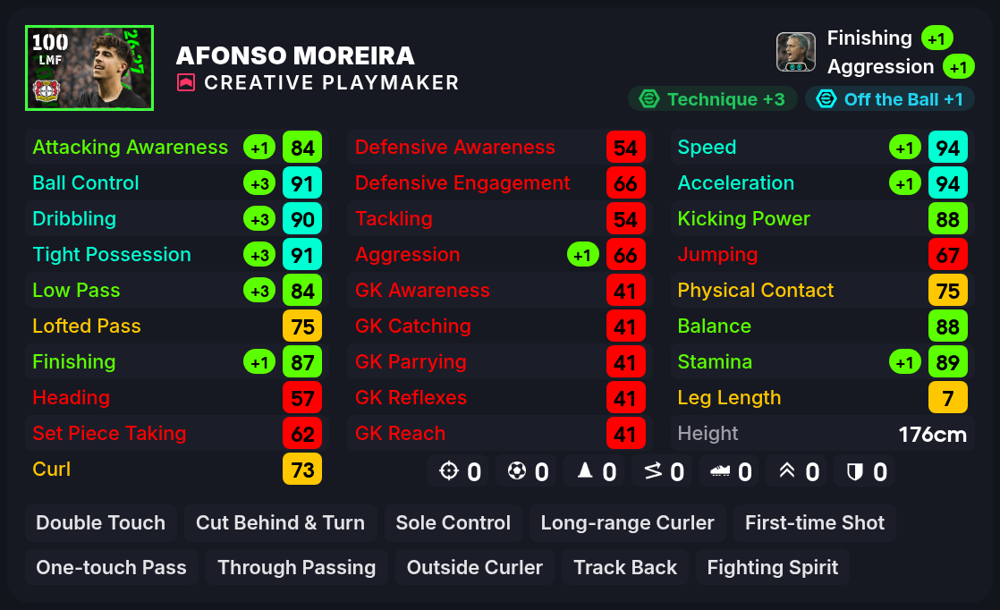

- **奥卡福尔（POTW）** 前腰 · 影子前锋：双增能 99，自带增能 Breakthrough +3，带超级替补技能。

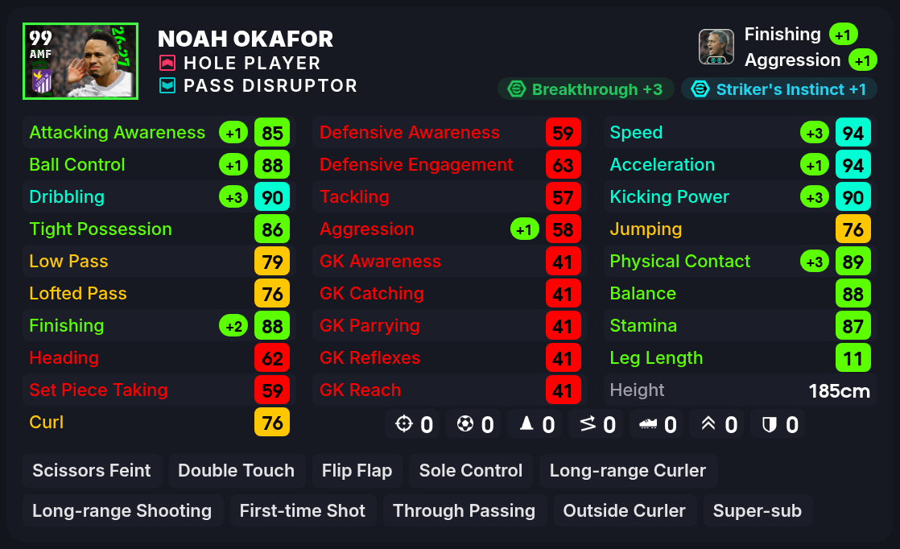

- **贾沙里（POTW）** 后腰 · 全能中场：双增能 99，自带增能 Shooting +3，带超级替补技能。

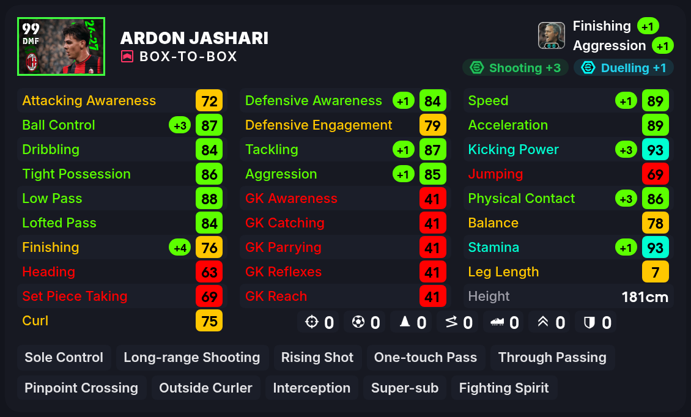

- **佐拉基斯（POTW）** 门将：双增能 99，自带增能 Saving +3。

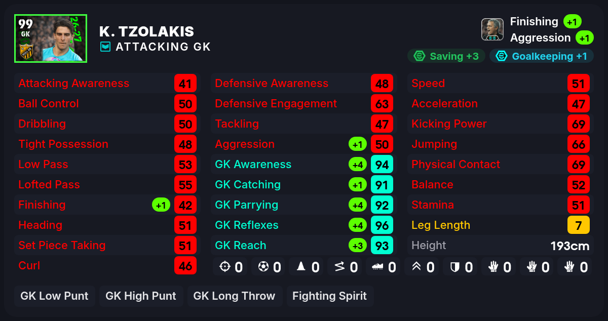

- **威廉姆斯-巴内特（POTW）** 左中场 · 影子前锋：双增能 99，自带增能 Ball-carrying +3。

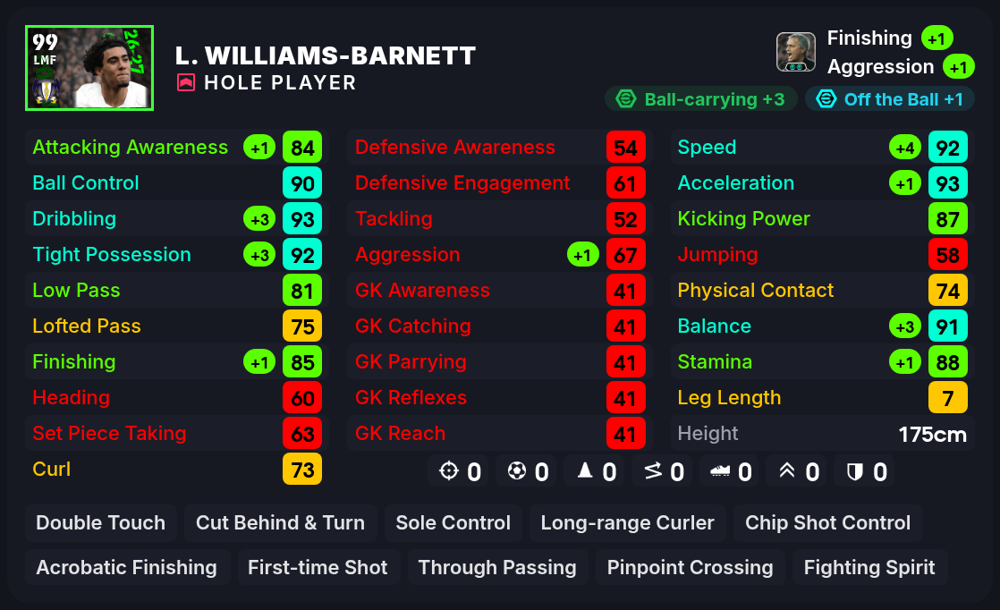

## 结论

本期 POTW 双增能口径 99-102，三人 102（阿尔瓦雷斯、维尔茨、马伦）。POTW 卡等级上限 1 级、不能加点，总评全靠教练和增能撑，定位即战力补充，强度低于同日 ST 包（双增能 105-107）。建议：缺中锋/前腰即战力的可以小抽；冲顶级战力的金币留给 Epic/ST 大包。
