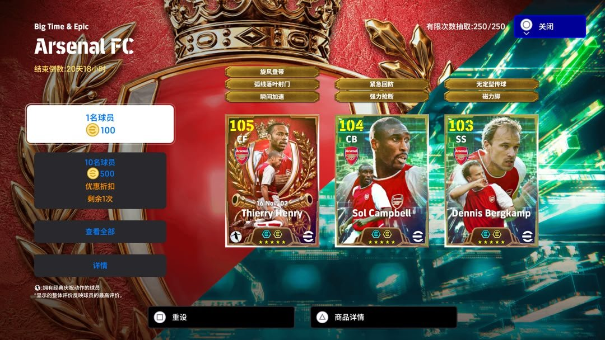
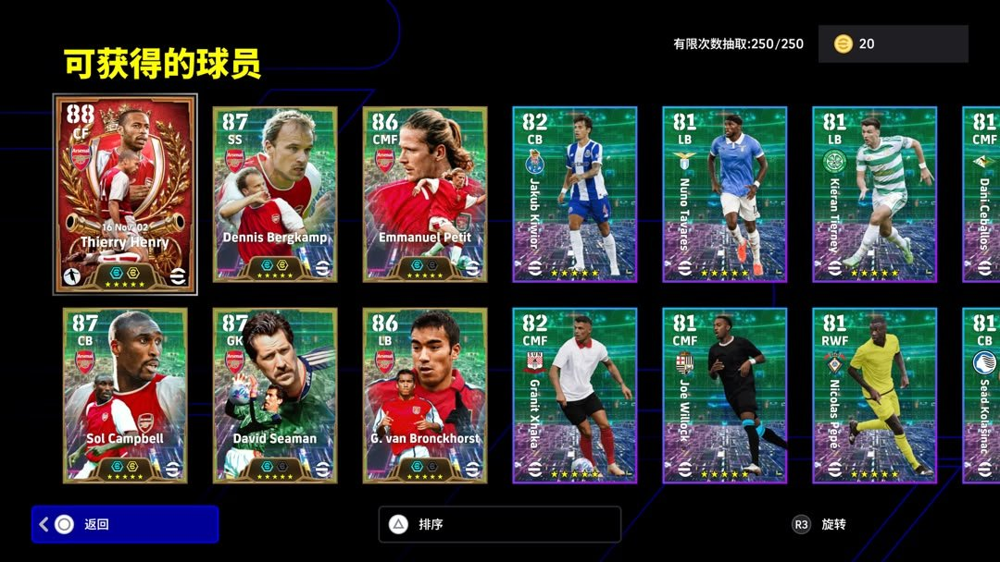

亨利（Big Time · 阿森纳包）加点照这套点，满级 105、速度 99、射门 101，抽到直接用。

## 主推 速度终结型：总评 105

射门 7 / 传球 4 / 盘带 6 / 灵巧 10 / 下肢力量 10 / 空中力量 4 / 防守 0 / 守门 0（共 62 点，正好用满）

满级关键数据：速度 99、射门 101、盘带 98、紧密控球 96、爆发力 95、射门力量 92、控球 91、平衡 90、弧线 88、进攻意识 89、体力 86、身体接触 84、地面传球 77、头球 65

思路：大模型 + 旋风盘带 + 瞬间加速，速度顶满 99 配瞬间加速，爆点没人追得上；射门 101 + 弧线 88，弧线落叶射门（金搓）能搓能爆；盘带 98 保证回撤拿球自己也能带。短板是进攻意识 89，跑位别全指望他自己，无球时手动拉一下前插。

## 备选 盘带手感型：总评 104

射门 4 / 传球 4 / 盘带 8 / 灵巧 12 / 下肢力量 8 / 空中力量 5 / 防守 0 / 守门 0

满级关键数据：盘带 99、紧密控球 98、速度 97、爆发力 97、射门 98、进攻意识 91、控球 93

适合喜欢自己带球过人的玩法，手感最顺，但总评和终结比主推套各低 1 点和 3 点。

## 卡面信息

Big Time 亨利，中锋，组织前锋，满级 32 级，共 62 点可分配，官方满级 105。自带双增能全开：护球 +6、射门 +8。以上数据为 eFHUB 计算器实测（双增能全开 + 教练 70 条件下）。

来源：https://efhub.com/players/89139361874801

出自阿森纳 250 人大包（100 币/抽，约至 2026-12-03）。

